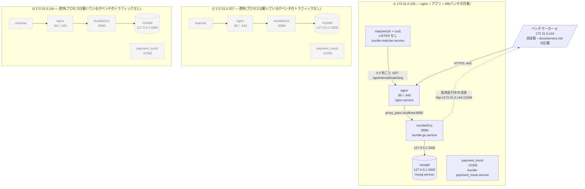
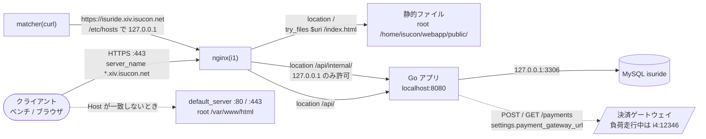
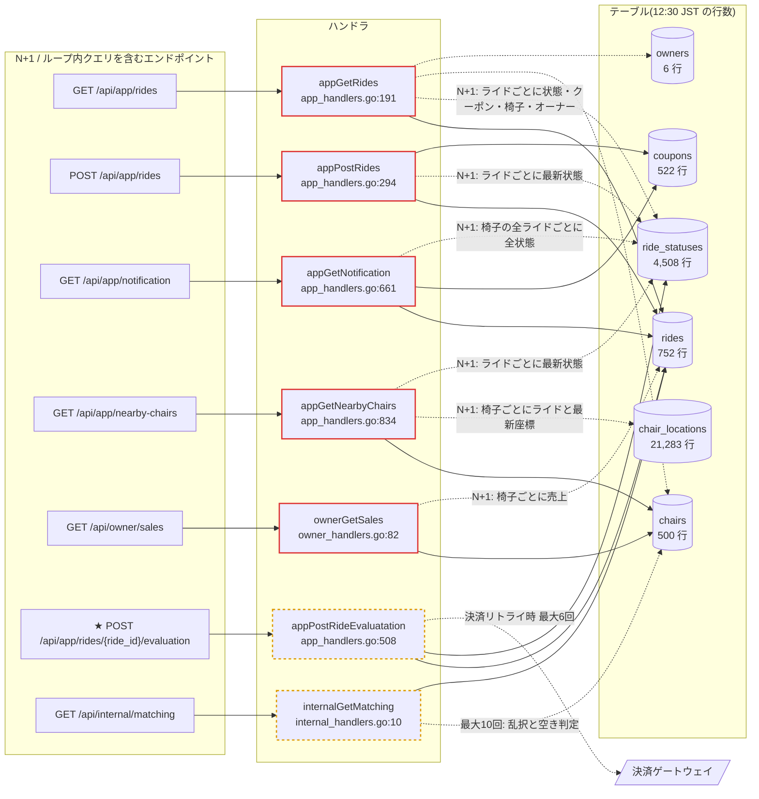
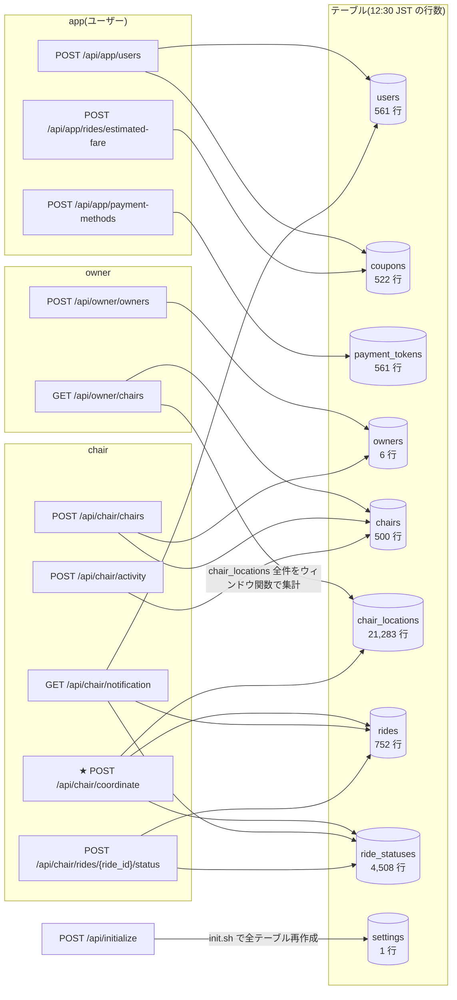
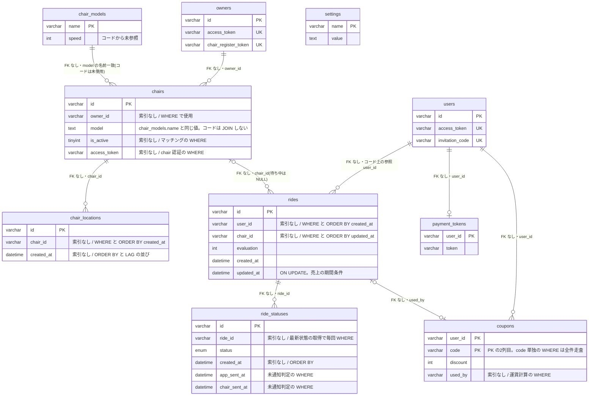
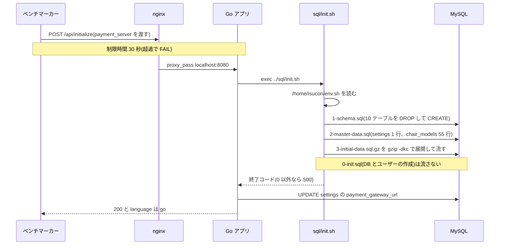

# ISUCON14 練習(ISURIDE) アプリ構成マップ(Go)

作成日: 2026-10-12 / 採取元: i1 i2 i3 / 対象コミット: `0bdb37f`(**本文の `ファイル:行` はすべてこのコミットの内容に対する行番号。** HEAD が進むと食い違うので、照合は `git show 0bdb37f:<file>` で行う)

`go/` と `sql/` の中身は `43eaf12` から変わっていない。i1 で稼働しているコードの HEAD は `43eaf12` なので、行番号はサーバー上のコードにもそのまま当てはまる。

> `isucon-app-map` スキルの成果物。**作成時点のスナップショットで、以後は更新しない。**
> 現在のサーバー構成は [`docs/servers.md`](../servers.md)、改善の進捗は Issue / PR を見る。
> **構造の記述であって施策の一覧ではない**(章11 だけが例外で、計測前の仮説として候補を書く)。
> 「どこが遅いか」は計測結果(alp / pt-query-digest / pprof)を別途この地図に重ねて読む。
> 生ログは `app-map-raw/`(`.gitignore` 済み・commit しない)。

## 目次

| 章 | 内容 | 図 |
|---|---|---|
| [0. 前提](#0-前提) | 大会ごとに変わる値の置き場 | — |
| [1. サマリ](#1-サマリ) | 3行。今の構成 / 遊んでいるリソース / 目立つ構造上の問題 | — |
| [2. 稼働プロセス構成](#2-稼働プロセス構成) | 台ごとに何が動いていて、どこにトラフィックが来ているか | `flowchart` |
| [3. リクエストの流れ](#3-リクエストの流れ) | nginx の location から アプリ / 静的ファイル / DB まで | `flowchart` |
| [4. エンドポイント一覧](#4-エンドポイント一覧) | メソッド / パス / ハンドラ / クエリ / N+1 / US | `flowchart`(1〜2枚) |
| [5. データモデル](#5-データモデル) | テーブル / 行数 / インデックス / 欠落している検索条件 | `erDiagram` |
| [6. 初期化処理](#6-初期化処理) | 何を再現しているか、変更時に守るべき整合性 | `sequenceDiagram` |
| [7. 設定の現状](#7-設定の現状) | nginx / DB / Go アプリの**稼働値** | — |
| [8. 外部依存 / 複数台構成の障害](#8-外部依存--複数台構成の障害) | 外部 API / ファイル / プロセスメモリの状態 | — |
| [9. 触ってはいけない範囲](#9-触ってはいけない範囲) | レギュレーション由来の失格条件 | — |
| [10. 目についた伸びしろ](#10-目についた伸びしろ) | 事実の列挙。優先順位はつけない | — |
| [11. 改善候補](#11-改善候補) | **計測前の仮説**。キャッシュ / インデックス / スキーマ / クエリ書き換え / 構成と設定、最初に手を入れる順、見送ったもの | — |
| [未確認](#未確認) | 採れなかった情報、読めなかった箇所 | — |

## 0. 前提

| 項目 | 値 | 出典 |
|---|---|---|
| アプリ名 | ISURIDE(椅子の配車サービス) | `docs/kickoff.md`、`docs/ISURIDE.md` |
| webapp のパス | `/home/isucon/webapp` | `docs/kickoff.md` |
| Go のディレクトリ / エントリポイント | `/home/isucon/webapp/go` / `go/main.go` の `main()`(`main.go:22`)。バイナリは `/home/isucon/webapp/go/isuride` | `app-map-raw/i1.md`(ユニット定義) |
| Go のバージョン | `go.mod` は `go 1.23`。手元の `go/isuride` は `go1.23.1` でビルドされている。サーバー上のバイナリは未確認(go コマンドが PATH に無い) | `go/go.mod`、`go version go/isuride` |
| Web フレームワーク | chi v5.1.0。ルートは Go 1.22 形式のパターン文字列(`"POST /api/..."`)で登録 | `go/go.mod`、`main.go:71-109` |
| DB ドライバ | sqlx v1.4.0 + go-sql-driver/mysql v1.8.1 | `go/go.mod` |
| systemd ユニット名(active) | `isuride-go.service`、`isuride-matcher.service`、`isuride-payment_mock.service`(3台とも同じ) | `app-map-raw/i1.md` `i2.md` `i3.md` |
| DB の種類とバージョン | MySQL 8.0.46(Ubuntu パッケージ)、DB 名 `isuride` | `app-map-raw/i1.md` |
| 初期化エンドポイント | `POST /api/initialize`(`main.go:71`、実装 `main.go:123-142`) | `docs/kickoff.md` |
| 制限時間(初期化) | 30 秒 | `docs/manual.md:310`, `:330` |
| pprof | 未組み込み(`net/http/pprof` の import なし、`:6060` の LISTEN なし) | `main.go:3-18`、`app-map-raw/i1.md` の LISTEN |
| US レポート | あり(`docs/us/report.md`、US-01〜US-03) | 章4 の US 列と章11 の材料 |

## 1. サマリ

- 負荷を受けているのは i1 の1台だけで、nginx・Go アプリ・MySQL・決済モック・matcher がすべて同居している。ベンチマーカーは i4 から i1 の 443 番に向く。
- i2 と i3 は i1 と同じプロセス一式が動いているが、ベンチのトラフィックは来ていない。CPU 2 コア・メモリ 3.7GiB(available 2.9GiB)がそのまま余っている。
- テーブルに主キー以外のインデックスがほとんど無く、ライドの最新状態を引く `ride_statuses` の全件走査が通知のポーリング(30ms 間隔指定)や N+1 のループの中で繰り返される。マッチングは 0.5 秒ごとに最大1件しか割り当てない。

## 2. 稼働プロセス構成

**作成時点の構成。現在の構成は [`docs/servers.md`](../servers.md) が正。**

採取は 2026-10-12 12:30 JST(03:30 UTC)。i4(ベンチマーカー専用)は採取していないので、`docs/servers.md` の記載をそのまま載せた。

### 台ごとの稼働プロセス

| ホスト | 役割 | CPU | メモリ | 動いているプロセス | LISTEN | 起動元ユニット | 備考 |
|---|---|---:|---:|---|---|---|---|
| i1 | nginx / app / db | 2 コア | 3.7GiB(available 2.6GiB) | nginx(worker 2)、isuride、mysqld、payment_mock、matcher(`sh -c while ... curl`) | 80, 443, 8080, 12345, 127.0.0.1:3306, 127.0.0.1:33060, 22 | nginx / isuride-go / mysql / isuride-payment_mock / isuride-matcher | mysqld の累計 CPU 3:20・RSS 約 559MiB(MEM 14.6%)、isuride の累計 CPU 0:25 |
| i2 | 遊休 | 2 コア | 3.7GiB(available 2.9GiB) | i1 と同じ一式 | i1 と同じ | i1 と同じ | mysqld の累計 CPU 0:31、isuride 0:04 |
| i3 | 遊休 | 2 コア | 3.7GiB(available 2.9GiB) | i1 と同じ一式 | i1 と同じ | i1 と同じ | mysqld の累計 CPU 0:44、isuride 0:05 |
| i4 | bench | 未採取 | 未採取 | 未採取 | 未採取 | 未採取 | `docs/servers.md` ではベンチマーカー専用。負荷走行中は決済モックを 12346 番で立てる |

**「動いている」と「使われている」は別物。** i2 と i3 でもアプリと MySQL は動いているが、mysqld の累計 CPU は i1 の 1/4〜1/6 にとどまる。i2・i3 の matcher も止まっておらず、`/etc/hosts` で `isuride.xiv.isucon.net` が `127.0.0.1` に解決されるため(3台とも `getent hosts` で確認)、各台の matcher は自分の台のアプリを 0.5 秒ごとに叩いている。i2・i3 の isuride に付いている CPU 時間はこの分だと推定する。

### 想定外のプロセス

| ホスト | プロセス | CPU% | MEM% | 起動元 | 備考 |
|---|---|---:|---:|---|---|
| i1 | `.warp/remote-server/oz-...` remote-server-daemon | 0.1 | 2.1 | user-1100.slice(isucon のログインセッション) | ターミナルツールのリモートサーバー。03:21 UTC 起動 |
| i2 | 同上 | 0.1 | 2.1 | 同上 | 03:22 UTC 起動 |
| i1, i2 | fwupd | 0.0 | 1.2 | fwupd.service | i3 では動いていない |

どれも数 % のメモリを使うだけで、性能への影響は小さいと見ている。

### 台ごとの差異

| 項目 | i1 | i2 | i3 |
|---|---|---|---|
| OS | Ubuntu 24.04.4 LTS / 6.17.0-1019-aws | 同じ | 同じ |
| nginx | 1.24.0。`nginx -T` の結果は3台で一致 | 同じ | 同じ |
| MySQL | 8.0.46。slow_query_log ON / long_query_time 0 | slow_query_log OFF / long_query_time 10 | i2 と同じ |
| Go | go コマンドなし(バイナリのみ) | 同じ | 同じ |
| アプリのユニット(enabled/active) | isuride-go enabled/active、他言語は disabled/inactive | 同じ | 同じ |
| `/etc/nginx`、`/etc/mysql` | リポジトリへの symlink | 同じ | 同じ |
| ログの量 | nginx 16M / mysql 158M | nginx 3.2M / mysql 12K | i2 と同じ |

MySQL の稼働値で違うのはスローログの2項目だけで、ほかはホスト名に由来する値(ログのファイル名など)しか差が無い。3台とも `/etc/mysql` は同じリポジトリを指しているので、差は設定ファイルの違いから来たものではない。キックオフの段5で i1 にだけ `make re` を実行しており、その中の `mrestart`(`Makefile`)が `SET GLOBAL` で `slow_query_log = 1` と `long_query_time = 0` を入れた。i2 と i3 には `make nrestart` しか実行していない。`SET GLOBAL` の値は MySQL を再起動すると消える。

## 3. リクエストの流れ

静的ファイル(`index.html`、`assets/`、`images/`)は nginx が `/home/isucon/webapp/public/` から直接返し、アプリは通らない。未知のパスは `index.html` に落とす SPA 向けの書き方になっている。`/api/` 以下はすべて `http://localhost:8080` に proxy し、`/api/internal/` だけは `allow 127.0.0.1; deny all;` で外から閉じている(`app-map-raw/i1-nginx.conf:244-260`)。

- アプリ → DB の接続先: `127.0.0.1:3306`。env の `ISUCON_DB_HOST` などから組み立てる(`main.go:29-60`、`/home/isucon/env.sh`)
- 追加ミドルウェア(Redis / memcached 等): 無し
- 実在しないパスを指している location: 見つかっていない。`default_server` の `root /var/www/html` は実在を確かめていない(Host が `*.xiv.isucon.net` でなければこちらに落ちるが、ベンチは `isuride.xiv.isucon.net` を使う)

## 4. エンドポイント一覧

ルートは `go/main.go:68-112` の `setup()` にすべて書かれていて、ほかのファイルには無い。全 18 本のハンドラをすべて開いて読んだ。

18 本を1枚に入れると読めないので、図は「N+1 やループ内クエリを含むもの」と「それ以外」の2枚に分けた。テーブルの行数は 12:30 JST の採取値(US 調査で作ったデータを含む。採取直後の 12:31 JST 頃に別のベンチが走ったので、今の行数とは違う)。

chair 系のうち認証付きの4本は、ハンドラに入る前に `chairAuthMiddleware` が `chairs` を `access_token` で引く(`middlewares.go:69`)。この列にはインデックスが無く、EXPLAIN は type=ALL だった。app 系と owner 系の認証は `users.access_token` と `owners.access_token` の UNIQUE インデックスで引けている(`middlewares.go:20`, `:45`)。全体には chi の `middleware.Logger` と `middleware.Recoverer` が掛かっている(`main.go:69-70`)。

US 列は `docs/us/report.md` の「3. 加点に至るリクエスト列」から埋めた。★ は加点地点。

| メソッド | パス | ハンドラ | 定義行 | 主なクエリ | N+1 | US | 備考 |
|---|---|---|---|---|---|---|---|
| POST | `/api/initialize` | `postInitialize` | `main.go:71` / `main.go:123` | `init.sh` 実行、UPDATE settings | — | — | 章6 |
| POST | `/api/app/users` | `appPostUsers` | `main.go:75` / `app_handlers.go:28` | INSERT users・coupons、招待時は coupons を `code` で FOR UPDATE(`:76`)、users を `invitation_code` で | — | US-01, US-02 | `:76` は PK の2列目だけの条件で全件走査 |
| POST | `/api/app/payment-methods` | `appPostPaymentMethods` | `main.go:78` / `app_handlers.go:141` | INSERT payment_tokens | — | US-01, US-02 | |
| GET | `/api/app/rides` | `appGetRides` | `main.go:79` / `app_handlers.go:191` | rides を `user_id` で全件(`:206`) | あり。`:214-259`。1ライドに最大4クエリ(状態 `:215`、クーポン `:975`、椅子 `:243`、オーナー `:252`) | — | US レポートには出てこない |
| POST | `/api/app/rides` | `appPostRides` | `main.go:80` / `app_handlers.go:294` | rides を `user_id` で全件(`:317`)、INSERT rides・ride_statuses、COUNT(`:359`)、coupons FOR UPDATE(`:367`, `:374`, `:401`) | あり。`:323-332`。ライドごとに最新状態 | US-01, US-02 | INSERT 直後に rides を読み戻す(`:419`) |
| POST | `/api/app/rides/estimated-fare` | `appPostRidesEstimatedFare` | `main.go:81` / `app_handlers.go:451` | coupons を `user_id` で(`:984`, `:990`) | — | US-01, US-02 | 読むだけの tx |
| POST | `/api/app/rides/{ride_id}/evaluation` | `appPostRideEvaluatation` | `main.go:82` / `app_handlers.go:508` | rides、最新状態、UPDATE rides、INSERT ride_statuses、payment_tokens、coupons(`used_by`)、settings、決済 HTTP | 決済リトライ時に最大6回(`payment_gateway.go:33-94` 内で `app_handlers.go:610`) | ★US-01, ★US-02 | 決済呼び出しが tx の中(`:608`) |
| GET | `/api/app/notification` | `appGetNotification` | `main.go:83` / `app_handlers.go:661` | rides 最新1件(`:673`)、未通知の状態(`:686`)、coupons(`:975`)、chairs、getChairStats | あり。`:779-812`。椅子の全ライドごとに ride_statuses 全件(`:784`) | US-01 | `retry_after_ms` 30(`:676`, `:723`) |
| GET | `/api/app/nearby-chairs` | `appGetNearbyChairs` | `main.go:84` / `app_handlers.go:834` | chairs 全件(`:878`) | あり(二重)。椅子ループ `:886-941` で rides(`:892`)・最新座標(`:919`)、内側のライドループ `:898-909` で最新状態 | US-01 | 距離判定は Go 側(`:930`) |
| POST | `/api/owner/owners` | `ownerPostOwners` | `main.go:89` / `owner_handlers.go:27` | INSERT owners | — | US-03 | |
| GET | `/api/owner/sales` | `ownerGetSales` | `main.go:92` / `owner_handlers.go:82` | chairs を `owner_id` で(`:113`) | あり。`:123-140`。椅子ごとに rides JOIN ride_statuses(`:125`) | US-03 | 初期オーナーは 100 台なので1リクエスト 101 クエリ |
| GET | `/api/owner/chairs` | `ownerGetChairs` | `main.go:93` / `owner_handlers.go:193` | chairs LEFT JOIN(chair_locations 全件の LAG 集計)(`:198-219`) | — | US-03 | オーナーに関係なく chair_locations 全件を毎回集計 |
| POST | `/api/chair/chairs` | `chairPostChairs` | `main.go:98` / `chair_handlers.go:23` | owners を `chair_register_token` で、INSERT chairs | — | — | |
| POST | `/api/chair/activity` | `chairPostActivity` | `main.go:101` / `chair_handlers.go:74` | UPDATE chairs | — | — | |
| POST | `/api/chair/coordinate` | `chairPostCoordinate` | `main.go:102` / `chair_handlers.go:97` | INSERT chair_locations、読み戻し(`:125`)、rides を `chair_id` で最新1件(`:131`)、最新状態、INSERT ride_statuses(PICKUP / ARRIVED) | — | ★US-01, ★US-02 | |
| GET | `/api/chair/notification` | `chairGetNotification` | `main.go:103` / `chair_handlers.go:187` | rides を `chair_id` で最新1件(`:201`)、未通知の状態(`:212`)、users FOR SHARE(`:228`) | — | US-01 | `retry_after_ms` 30(`:204`, `:264`) |
| POST | `/api/chair/rides/{ride_id}/status` | `chairPostRideStatus` | `main.go:104` / `chair_handlers.go:272` | rides FOR UPDATE(`:292`)、INSERT ride_statuses | — | US-01, US-02 | 不正な status で `return` が無い(`:328-330`) |
| GET | `/api/internal/matching` | `internalGetMatching` | `main.go:109` / `internal_handlers.go:10` | 待ちライド最古1件(`:14`)、`ORDER BY RAND()` の椅子(`:26`)、空き判定(`:34`)、UPDATE rides(`:47`) | 上限つきループ `:25-41`(最大10回 × 2クエリ) | US-01 | matcher からのみ。エラー時に `return` が無い(`:31`) |

- 総数: 18 本
- うち N+1 を含むもの: 5 本(件数に比例するもの。ほかに上限つきループのクエリが matching と evaluation の2本)
- スコア加点に直結するもの: `POST /api/chair/coordinate`(★US-01, ★US-02。移動距離の加点)と `POST /api/app/rides/{ride_id}/evaluation`(★US-01, ★US-02。ライド完了)
- ベンチが叩かないもの: マニュアルに明記は無い。`/api/internal/matching` は nginx が 127.0.0.1 以外を拒否するので、外のベンチからは届かない

加点の2本はどちらも N+1 を含まないが、前後で何度も呼ばれる通知・nearby・matching を経由しないとライドが進まない。スコアは「マッチ位置→乗車位置の距離 × 0.1 + 乗車位置→目的地の距離 + 完了数 × 5」(`docs/manual.md` のスコア計算)なので、ライドを早く回すこと自体が得点になる。

## 5. データモデル

| テーブル | 行数 | データ長 | インデックス長 | 主キー | その他のインデックス |
|---|---:|---:|---:|---|---|
| chair_locations | 21,283 | 2,576 KB | 0 KB | id | 無し |
| ride_statuses | 4,508 | 496 KB | 0 KB | id | 無し |
| rides | 752 | 144 KB | 0 KB | id | 無し |
| users | 561 | 144 KB | 208 KB | id | UNIQUE(username)、UNIQUE(access_token)、UNIQUE(invitation_code) |
| payment_tokens | 561 | 128 KB | 0 KB | user_id | 無し |
| coupons | 522 | 96 KB | 0 KB | (user_id, code) | 無し |
| chairs | 500 | 128 KB | 0 KB | id | 無し |
| chair_models | 55 | 16 KB | 0 KB | name | 無し |
| owners | 6 | 16 KB | 48 KB | id | UNIQUE(name)、UNIQUE(access_token)、UNIQUE(chair_register_token) |
| settings | 1 | 16 KB | 0 KB | name | 無し |

行数は 12:30 JST の `COUNT(*)`(`app-map-raw/db-schema.md`)。初期データ(章6)に US 調査で作ったユーザー2人・オーナー1社・ライド2件などが足されている。ID はすべて ULID の `VARCHAR(26)` で、BLOB のような大きな列は無い。

### インデックスが無い検索条件

| テーブル | 列 | 使われ方 | 使っているエンドポイント |
|---|---|---|---|
| ride_statuses | `ride_id`, `created_at` | WHERE `ride_id = ?` ORDER BY `created_at`(`app_handlers.go:288` の getLatestRideStatus、`:686`、`:784`、`chair_handlers.go:212`)/ JOIN と GROUP BY(`owner_handlers.go:125`、`internal_handlers.go:34`) | ほぼすべて。getLatestRideStatus だけで呼び出し元が8か所 |
| rides | `chair_id`, `updated_at` / `created_at` | WHERE `chair_id = ?` ORDER BY `updated_at DESC`(`chair_handlers.go:131`, `:201`、`app_handlers.go:770`)、ORDER BY `created_at DESC`(`app_handlers.go:892`)、`chair_id IS NULL ORDER BY created_at`(`internal_handlers.go:14`)、`updated_at BETWEEN`(`owner_handlers.go:125`) | ★coordinate、chair/notification、app/notification、nearby-chairs、owner/sales、matching |
| rides | `user_id`, `created_at` | WHERE `user_id = ?` ORDER BY `created_at`(`app_handlers.go:206`, `:610`, `:673`)、`user_id = ?`(`:317`, `:359`) | app/rides、POST app/rides、★evaluation、app/notification |
| chair_locations | `chair_id`, `created_at` | WHERE `chair_id = ?` ORDER BY `created_at DESC LIMIT 1`(`app_handlers.go:919`)、`PARTITION BY chair_id ORDER BY created_at`(`owner_handlers.go:214-215`) | nearby-chairs、owner/chairs |
| chairs | `access_token` | WHERE(`middlewares.go:69`) | chair 認証付きの4本(★coordinate を含む) |
| chairs | `owner_id` | WHERE(`owner_handlers.go:113`, `:218`) | owner/sales、owner/chairs |
| coupons | `used_by` | WHERE(`app_handlers.go:975`) | app/rides、POST app/rides、★evaluation、app/notification |
| coupons | `code` | WHERE `code = ?` FOR UPDATE(`app_handlers.go:76`) | POST app/users(招待コードあり) |
| chairs | `is_active` | WHERE `is_active = TRUE ORDER BY RAND()`(`internal_handlers.go:26`) | matching。値は2種類だけ |

上の列を使うクエリは i1 の EXPLAIN でいずれも type=ALL(全件走査)になり、ORDER BY を伴うものは filesort も出た。全件走査の対象が一番大きいのは `chair_locations` で、2万行超を nearby-chairs の椅子ごとに読み直している。

### 外部キー

外部キー制約は1つも無い(`app-map-raw/db-schema.md`)。上の図の関係はすべてコード上の参照から起こした。

## 6. 初期化処理

- エンドポイント: `POST /api/initialize`(`main.go:71`、実装 `main.go:123-142`)
- 制限時間: 30 秒(`docs/manual.md:310`, `:330`)。初期化が失敗すると負荷走行は即 FAIL。12:31:45 JST のベンチでは `reqtime:1.086`(i1 の nginx access.log、この1件しか見ていない)
- レスポンス形式: `{"language":"go"}` を 200 で返す(`main.go:141`)。`language` に実装言語を入れる必要がある(`docs/kickoff.md`)

初期化の本体は外部プロセスの `init.sh` で、アプリはそれを待ってから決済先の URL を書き換えるだけだ。`exec.Command("../sql/init.sh")`(`main.go:131`)は相対パスなので、systemd の `WorkingDirectory=/home/isucon/webapp/go` が前提になる。init.sh は `/home/isucon/env.sh` を読み、`ISUCON_DB_HOST` などで接続先を決める(`sql/init.sh:10-18`)。DB を別の台に移しても、アプリ台の env.sh を変えれば初期化もそちらに流れる。

流すファイルは3つで、データベース自体は作り直さない。`1-schema.sql` が 10 テーブルを `DROP TABLE IF EXISTS` してから作り直し、`2-master-data.sql` が settings(`payment_gateway_url = http://localhost:12345`)と chair_models 55 行(speed 2 / 3 / 5 / 7)を入れる。最後に `3-initial-data.sql.gz`(圧縮 821,000 バイト、展開 3,253,617 バイトの mysqldump)を流す。そのあとアプリが `UPDATE settings SET value = ? WHERE name = 'payment_gateway_url'`(`main.go:136`)でベンチの指定した決済先に差し替える。

初期データの中身は次のとおり(gz の INSERT を数えた値)。

| テーブル | 行数 | 中身の特徴 |
|---|---:|---|
| chair_locations | 21,209 | 最大のテーブル。椅子1台あたり平均 55 行、最大 305 行(i1 で集計) |
| ride_statuses | 4,496 | MATCHING / ENROUTE / ARRIVED / COMPLETED 各 750、PICKUP / CARRYING 各 748。`app_sent_at` と `chair_sent_at` はすべて埋まっている |
| rides | 750 | すべて椅子割り当て済み・評価済み。2024-11-25〜26 の日付 |
| users / payment_tokens | 559 / 559 | |
| coupons | 518 | `RWD_*` 259、`INV_*` 259。`CP_NEW2024` は無い |
| chairs | 500 | すべて `is_active = 0` |
| owners | 5 | 各社 100 台 |

PICKUP と CARRYING を欠いたライドが2件ある。matching の空き判定は「その椅子の全ライドで6状態すべてが椅子に通知済み」を求める(`internal_handlers.go:34`)ので、このライドを持つ椅子は空きと判定されない。初期データの椅子はすべて非アクティブなので、実害が出るかは確かめていない。

**変更時に守るべき整合性。** スキーマを変えたときに一番効く制約は、`1-schema.sql` が毎回テーブルを作り直すことだ。DB に直接 `ALTER TABLE` で足したインデックスや列は、次の初期化で消える。インデックスは `1-schema.sql` に書く必要がある。

列を足すときはもう一段注意が要る。`3-initial-data.sql.gz` は列名を書かない `INSERT INTO ... VALUES (...)` 形式なので、既存のテーブルに列を足すと列数が合わずに投入が失敗する。DEFAULT を付けても同じだ。非正規化した値(最新状態、最新座標、累計距離など)を持つなら、別テーブルにするか、投入後に init.sh の中で `ALTER` と `UPDATE` を流して埋める。後から埋める処理が重くなれば、30 秒の制限に近づく。

- **初期化が消さないもの** — 今のアプリはプロセスメモリに状態を持たない(`sync`・`map` のグローバル変数なし)ので、該当なし。キャッシュを足すなら `postInitialize` で捨てる処理が要る。アプリを複数台に置くと、初期化のリクエストは1台にしか来ない。matcher(各台の `isuride-matcher.service`)は初期化中も止まらずにポーリングを続ける。

## 7. 設定の現状

### nginx(`app-map-raw/i1-nginx.conf` より)

3台の `nginx -T` は一致した。

| 項目 | 現在値 | 備考 |
|---|---|---|
| worker_processes | auto(2 コアなので worker 2) | ps の worker 数と一致 |
| worker_connections | 768 | Ubuntu の既定値のまま |
| gzip | on。`gzip_types` の指定なし | nginx の既定では text/html だけが圧縮対象で、JSON は圧縮されない |
| keepalive(upstream) | 無し。`upstream` ブロックを使わず `proxy_pass http://localhost:8080` を直書き | `proxy_http_version` 未指定なので nginx → アプリは HTTP/1.0。アプリのログにも `HTTP/1.0` と出ている |
| access_log の形式 | LTSV(`log_format ltsv`) | alp で集計できる |

### DB(`app-map-raw/db-schema.md` の稼働値より)

| 項目 | 現在値 | 備考 |
|---|---|---|
| バッファプールのサイズ | 128MiB(`innodb_buffer_pool_size 134217728`) | 実メモリ 3.7GiB の約 3.4%。今のデータ(合計 4MB 弱)は収まる |
| コミット時のフラッシュ設定 | `innodb_flush_log_at_trx_commit 1`、`log_bin ON`、`sync_binlog 1` | 書き込みのたびに fsync。永続化は追試の条件(章9) |
| max_connections | 151 | アプリ側のプール上限は未設定(無制限) |
| bind_address | 127.0.0.1 | 他の台からは接続できない。ユーザーは `'isucon'@'%'` があるので、変えるのは bind_address だけで済む |
| スロークエリログの設定 | i1: ON / `long_query_time 0`(全クエリを記録)。i2・i3: OFF / 10 | i1 の mysql ログは 158M まで育っている |
| トランザクション分離レベル | REPEATABLE-READ | `app-map-raw/i1-mysql.txt:620` |

### Go アプリ

| 項目 | 現在値 | 場所 |
|---|---|---|
| `SetMaxOpenConns` | 未設定(database/sql の既定は無制限) | `main.go:62-66` |
| `SetMaxIdleConns` | 未設定(既定は 2) | 同上 |
| `SetConnMaxLifetime` | 未設定 | 同上 |
| DSN のパラメータ | `ParseTime=true` のみ。`InterpolateParams` は未設定(false)なので、プレースホルダ付きのクエリはサーバー側プリペアドになる | `main.go:54-60` |
| デバッグフラグ(`e.Debug` 等) | 該当なし(chi にこの機能は無い) | — |
| ログミドルウェア | `middleware.Logger` が全リクエストを stdout に出し、journald に入っている(`journalctl -u isuride-go` で確認) | `main.go:69` |
| `http.Server` のタイムアウト | 未設定。`http.ListenAndServe(":8080", mux)` を直接呼び、戻り値のエラーも捨てている | `main.go:24-25` |
| 外部通信の `http.Client` | `http.DefaultClient`(タイムアウトなし) | `payment_gateway.go:42`, `:56` |
| トランザクションの開始 | すべて `db.Beginx()`(context なし)。全箇所に `defer tx.Rollback()` あり | `app_handlers.go:44` ほか |
| pprof | 未組み込み | `main.go:3-18` |

## 8. 外部依存 / 複数台構成の障害

外部への依存は決済ゲートウェイ1つで、ファイル保存もプロセスメモリの状態も無い。複数台にするときに気をつけるのは matcher の扱いくらいだ。

- 外部 API / モック(叩き先・ポート): 決済ゲートウェイ。URL は `settings.payment_gateway_url` から毎回読む(`app_handlers.go:603`)。負荷走行中はベンチ自身が立てる `http://172.31.0.144:12346`、手で触るときは各台のモック `:12345`(`isuride-payment_mock.service`)。`Idempotency-Key` ヘッダは送っていない(`payment_gateway.go:39-40`。仕様上は使える、`docs/ISURIDE.md:191-193`)
- ファイル保存先(複数台化で壊れるもの): 無し。静的ファイルは配布物の `public/` を nginx が返すだけ
- プロセスメモリに持っている状態(`map` キャッシュ / カウンタ / セッション): 無し。セッションは Cookie のトークンを毎回 DB で引く
- アプリ内での ID 採番: ULID(`ulid.Make()`)とトークン(`crypto/rand`、`main.go:178-184`)。複数プロセスでも衝突しない作り
- cron / タイマー: isucon の crontab は無い。代わりに `isuride-matcher.service` が `curl` を 0.5 秒ごとに回すループで、3台すべてで動いている。アプリを複数台にしたら、マッチングを走らせるのは DB を共有する中の1台に限る必要がある

## 9. 触ってはいけない範囲

- URI、レスポンス JSON の構造、JS / CSS、画像は変えない(`docs/regulation.md:52-60`)。ID の文字種を変えない範囲での生成方法の変更は許される
- `envcheck.service` 関連ファイル、`/opt/isucon-env-checker`、`isuadmin` ユーザーは変えない。変えると失格(`docs/manual.md:135-143`)
- セキュリティグループの 22 / 443 は変えない(`docs/manual.md:131-133`)
- 追試では3台を順不同で再起動してから負荷走行する。再起動後に動かない、envcheck に失敗する、最終スコアの 75% 以下が3回続く、のいずれも失格(`docs/manual.md:440-457`)
- 負荷走行で書き込まれたデータは、再起動後も取得できなければならない(`docs/regulation.md:84`、`docs/manual.md:454-455`)
- 負荷走行の打ち切り(FAIL)条件: クリティカルエラー(想定外の通知、通知の順序違反、椅子が完了通知を受け取る前に次のライドの通知、長時間マッチングされないライド、評価のタイムアウト、評価済みで未払いのライド、誤った支払い)と、200 件以上のワーニング(`docs/manual.md:337-353`)
- 負荷終了時点で進行中の決済は、終了後 5 秒以内に完了していなければならない(`docs/manual.md:322`)
- 通知は、すべての状態遷移を発生順に少なくとも1回ずつ返す(`docs/ISURIDE.md:158-170`)。状態が変わってから3秒以内の通知が期待されている(`docs/ISURIDE.md:96`)
- nearby-chairs の座標は過去3秒以内に送られた座標と一致する必要がある。owner/chairs の移動距離の反映も3秒まで遅れてよい(`docs/manual.md:355-358`)
- ベンチマーク中に、認められたサーバー以外の外部リソースへ処理を委譲しない(`docs/regulation.md:64`)

逆に、`/api/internal/matching` と `isuride-matcher.service` は仕様を自由に変えてよいと明記されている(`docs/ISURIDE.md:174-180`)。

## 10. 目についた伸びしろ

**事実の列挙にとどめる。優先順位はつけない。「こう直す」も書かない(それは章11)。**

- i2・i3 はアプリも MySQL も動いているが、ベンチのトラフィックは来ていない(章2、`app-map-raw/i2.md` `i3.md` の累計 CPU)
- `ride_statuses.ride_id` にインデックスが無く、最新状態の取得(`app_handlers.go:288`)が呼び出しのたびに全件走査になる。呼び出し元は8か所で、うち3か所はループの中(`app_handlers.go:215`, `:324`, `:900`)
- `rides.chair_id`、`rides.user_id`、`chair_locations.chair_id`、`chairs.access_token`、`chairs.owner_id`、`coupons.used_by`、`coupons.code` にインデックスが無い(章5)
- 通知の2本は `retry_after_ms` に 30 を返す(`app_handlers.go:676`, `:723`、`chair_handlers.go:204`, `:264`)。クライアントは 30ms ごとに再リクエストする(`docs/ISURIDE.md:101-102`)
- app/notification は椅子が付いている間、毎回その椅子の全ライドと全状態を読む(`app_handlers.go:763-820`)
- nearby-chairs は椅子を全件読み、アクティブな椅子ごとにライドと最新座標を読み、ライドごとに最新状態を読む(`app_handlers.go:878-941`)
- owner/chairs は `chair_locations` 全件にウィンドウ関数(`LAG() OVER`)をかけてから自分の椅子に絞る(`owner_handlers.go:198-219`)
- owner/sales は椅子1台ごとにクエリを投げる(`owner_handlers.go:123-140`)
- matching は1回の呼び出しで最古の1ライドしか割り当てず(`internal_handlers.go:14`)、椅子は `ORDER BY RAND()` で選ぶ(`:26`)。距離も速度も見ない。matcher の間隔 0.5 秒(env.sh)と合わせると、割り当ては最大で毎秒2件程度になる
- `chair_models.speed` はコードから一度も読まれていない(`models.go:19` に構造体があるだけ)
- 評価のハンドラは決済の HTTP 呼び出しを tx の中で行い(`app_handlers.go:608`)、失敗時は 100ms 待って最大5回リトライする(`payment_gateway.go:84-91`)
- `payment_gateway.go:60` は `defer res.Body.Close()` になっていて、GET /payments のレスポンス `getRes.Body` を閉じていない
- 決済先 URL を評価のたびに settings から読む(`app_handlers.go:603`)
- INSERT した行を、`created_at` を返すためだけに読み戻している(`chair_handlers.go:125`、`app_handlers.go:419`, `:574`)
- nearby-chairs は時刻を取るためだけに `SELECT CURRENT_TIMESTAMP(6)` を投げる(`app_handlers.go:944-948`)
- `middleware.Logger` が全リクエストを journald に書いている(`main.go:69`)
- コネクションプールの設定、`InterpolateParams`、`http.Server` のタイムアウトがいずれも無い(章7)
- nginx → アプリが HTTP/1.0 で keepalive が無く、JSON は gzip されない(章7)
- MySQL のバッファプールは 128MiB で、メモリ 3.7GiB の約 3.4%(章7)
- pprof が組み込まれていない(`main.go:3-18`)
- `writeError` の後に `return` が無い箇所が2つある(`internal_handlers.go:31`、`chair_handlers.go:328-330`)
- `chair_handlers.go:142` は `'CANCELED'` と比べているが、`ride_statuses.status` の ENUM に CANCELED は無い(`sql/1-schema.sql:102`)

## 11. 改善候補

**計測前の仮説。** 章2〜10 の構造、マニュアルの採点式・失格条件、US の加点経路(`docs/us/report.md`)から導く。**初回ベンチの alp / pt-query-digest で見直す。** 各行に根拠(`ファイル:行` / テーブル.列 / 採取ファイル名)と、効くエンドポイント(US 列で `★` のものは US ID も)を必ず添える。該当なしの分類は「該当なし」と書いて残す。

筆者の見立てでは、効きそうな候補は3つの塊に分かれる。インデックスの欠落、ライドの状態や椅子の位置を毎回履歴から計算し直す構造、そして1件ずつしか割り当てないマッチングだ。インデックスは `1-schema.sql` の数行で済む。残りの2つはスキーマや仕様に手が入るぶん、初期化と通知順序の整合を崩さないかを確かめながら進めることになる。

### 11.1 キャッシュできそうな箇所

キャッシュの効きどころは、毎回 DB に聞いている「ほぼ変わらない値」と、毎回履歴から計算している「椅子ごとの現在値」の2種類ある。前者は今すぐメモリに持てるが、後者は初期データから値を作る処理が要る。

| 対象データ | 読んでいる箇所 | 更新される箇所 | 効くエンドポイント | 初期化との整合 | 複数台での扱い |
|---|---|---|---|---|---|
| 決済先 URL(`settings.payment_gateway_url`) | `app_handlers.go:603` | `main.go:136` のみ | ★evaluation(★US-01, ★US-02) | `postInitialize` で値を入れ直せば整合する | プロセス内。initialize が来ない台は古い値のままになるので、DB から読み直す経路を残す |
| 認証トークン → ID(chair / user / owner) | `middlewares.go:20`, `:45`, `:69` | 作成時のみ(`chair_handlers.go:48`、`app_handlers.go:51`、`owner_handlers.go:43`)。トークンを更新するコードは無い | 認証付きの全エンドポイント。chair 系は索引なしの全件走査を避けられる(★coordinate) | 初期化でテーブルが作り直されるので、`postInitialize` で捨てる | プロセス内。作成した台以外には無いので、見つからなければ DB を引く |
| 椅子の最新座標 | `app_handlers.go:919` | `chair_handlers.go:115` | nearby-chairs(US-01) | 初期データの chair_locations から作る | プロセス内なら座標の POST と nearby が同じ台に来る前提。3秒以内の一致が要る(章9) |
| 椅子の累計移動距離 | `owner_handlers.go:198-219` | `chair_handlers.go:115` | owner/chairs(US-03) | 初期データから累計を計算して作る | 反映は3秒まで遅れてよい(章9) |
| 椅子の統計(完了ライド数・評価平均) | `app_handlers.go:763-820` | `app_handlers.go:549-568`(評価時) | app/notification(US-01) | 初期データから計算して作る | — |
| chair_models の速度 | 今は未参照 | マスタ(`2-master-data.sql`) | matching(11.4 の作り直しで使うなら) | 初期化で変わらない | 各台で同じ値 |

### 11.2 必要そうなインデックス

すべて `sql/1-schema.sql` に足す。DB に直接 ALTER しても次の初期化で消える(章6)。行数は最大でも2万台なので、初期化の時間(今は約1.1秒)が 30 秒に近づく心配は小さいと見ている。降順の ORDER BY は、昇順のインデックスを逆向きに読んで処理される。

| テーブル | インデックス(列の順序) | 効くクエリ | 使うエンドポイント | 注意 |
|---|---|---|---|---|
| ride_statuses | `(ride_id, created_at)` | `app_handlers.go:288`(呼び出し元8か所)、`:686`、`:784`、`chair_handlers.go:212`、`owner_handlers.go:125` の JOIN、`internal_handlers.go:34` | ほぼ全部。★coordinate、★evaluation、通知2本、nearby、matching | `app_sent_at IS NULL` などの条件は1ライド最大6行の中で絞るので、2列で足りると見ている |
| rides | `(chair_id, updated_at)` | `chair_handlers.go:131`, `:201`、`app_handlers.go:770`、`owner_handlers.go:125`(`updated_at BETWEEN`)、`app_handlers.go:892`、`internal_handlers.go:34` | ★coordinate、chair/notification、app/notification、nearby、owner/sales、matching | matching の `chair_id IS NULL ORDER BY created_at`(`internal_handlers.go:14`)には `(chair_id, created_at)` のほうが合う。どちらにするかは pt-query-digest で決める |
| rides | `(user_id, created_at)` | `app_handlers.go:206`, `:317`, `:359`, `:610`, `:673` | app/notification、POST app/rides、app/rides、★evaluation | — |
| chair_locations | `(chair_id, created_at)` | `app_handlers.go:919` | nearby-chairs | owner/chairs の全件集計(`owner_handlers.go:198-219`)はインデックスだけでは軽くならない。11.3 の累計距離とセット |
| chairs | `UNIQUE (access_token)` | `middlewares.go:69` | chair 認証付きの4本(★coordinate) | users・owners には既にある |
| chairs | `(owner_id)` | `owner_handlers.go:113`, `:218` | owner/sales、owner/chairs | — |
| coupons | `(used_by)` | `app_handlers.go:975` | app/notification、app/rides、POST app/rides、★evaluation | — |
| coupons | `(code)` | `app_handlers.go:76`(FOR UPDATE) | POST app/users(招待コードあり) | インデックスが無いと、FOR UPDATE が走査した行すべてにロックを取る。負荷中に招待コードつきの登録が来るかは未確認 |

### 11.3 スキーマとテーブル分割

どれも「履歴テーブルを毎回なめて現在値を出す」構造を、現在値を持つ形に変える案だ。共通の制約が2つある。初期データが列名なしの INSERT なので、既存テーブルへの列追加は投入を壊す(章6)。もう一つ、状態を書き込む箇所すべてで現在値も更新しないと、通知の順序や空き判定が崩れる。

| テーブル | 何をどう変えるか | 効くクエリ / エンドポイント | 初期化との整合 | 注意 |
|---|---|---|---|---|
| ride_statuses → 新テーブル(または rides に後付けの列) | ライドの最新状態を ride_id 単位で持つ | getLatestRideStatus の8か所(`app_handlers.go:286-292`)。ループ内の `:215`, `:324`, `:900` が消える | init.sh の投入後に ride_statuses から作る | 状態を INSERT している6か所(`app_handlers.go:349`, `:565`、`chair_handlers.go:144`, `:151`, `:309`, `:324`)すべてで更新する |
| chair_locations → 新テーブル(chair_id 主キー) | 椅子ごとの最新座標と累計距離を持つ | nearby-chairs(`app_handlers.go:919`)、owner/chairs(`owner_handlers.go:198-219`) | 投入後に chair_locations から計算する | 書き込みは `chair_handlers.go:115` の1か所に集まっているので更新漏れは起きにくい。座標の3秒ルール(章9) |
| chairs → 新テーブルまたは列 | 「空き / 割当中」を明示的に持つ | matching の空き判定(`internal_handlers.go:34`)、nearby の N+1(`app_handlers.go:892-909`) | 初期データでは全ライド完了済み。PICKUP / CARRYING 欠けの2ライドを持つ椅子の扱いが今と変わりうる(章6) | 今の判定は「6状態すべてを椅子に通知済み」で、COMPLETED かどうかだけでは決めていない。ここを変えると「椅子が完了通知を受け取る前に次のライドの通知」(クリティカル)に触れうる |
| chairs → 新テーブルまたは列 | 完了ライド数と評価合計を持つ | app/notification の getChairStats(`app_handlers.go:763-820`) | 投入後に rides と ride_statuses から計算 | 今の集計は ARRIVED・CARRYING・COMPLETED がそろったライドだけを数える(`:803-808`)。COMPLETED だけで数えると値が変わりうる |

### 11.4 クエリとコードの書き換え

最も厚く検討したのはマッチングで、ここだけは仕様ごと変えてよいと明記されている(`docs/ISURIDE.md:180`)。今は 0.5 秒に1件、椅子はランダムで、距離も速度も見ない。スコアは移動距離と完了数で決まり(`docs/manual.md` のスコア計算)、評価は配車までの時間や近い椅子の割り当てで上がる(`docs/ISURIDE.md:53-57`)。割り当ての数と質の両方がそのまま点に響く。

| 箇所 | 今の形 | 変え方 | 効くエンドポイント | 注意 |
|---|---|---|---|---|
| `internal_handlers.go:14-47` | 最古の1ライドに、ランダムな空き椅子を最大10回試して割り当てる | 待ちライドを全件まとめて、空き椅子と距離・速度(`chair_models.speed`)で割り当てる。matcher の間隔(env.sh)も見直す | matching → 加点全体(★US-01, ★US-02) | 空き判定の意味(6状態を通知済み)を保つ。複数台では1台だけで走らせる |
| `app_handlers.go:767-812` | getChairStats が椅子の全ライドと全状態を引き、Go で数える | 1クエリの集計か、11.3 の保持値に置き換える | app/notification(US-01) | 完了の数え方を変えない |
| `app_handlers.go:878-941` | 椅子全件 → 椅子ごとにライドと最新座標 → ライドごとに最新状態 | 空き椅子 × 最新座標を1〜2クエリで取る | nearby-chairs(US-01) | 座標の3秒ルール |
| `app_handlers.go:214-259` | ライドごとに状態・クーポン・椅子・オーナーを1件ずつ | JOIN と最新状態の一括取得 | app/rides | レスポンス形式を変えない |
| `app_handlers.go:317-332` | ユーザーの全ライドの最新状態を1件ずつ見て、進行中があるか判定 | 進行中ライドの有無を1クエリで | POST app/rides(US-01, US-02) | — |
| `owner_handlers.go:123-140` | 椅子ごとに売上クエリ | `chair_id IN (...)` と GROUP BY で1クエリ | owner/sales(US-03) | 期間条件は `rides.updated_at`(評価時刻)のまま |
| `app_handlers.go:608`、`payment_gateway.go:24-97` | 決済の HTTP を tx の中で同期に呼ぶ。`Idempotency-Key` なし | tx を先に commit してから決済し、`Idempotency-Key` を付けてリトライする | ★evaluation(★US-01, ★US-02) | 「評価済みで未払い」「誤った支払い」はクリティカル。負荷終了後5秒以内の決済完了も要る(章9)。決済失敗時に評価だけが残る経路を作らない |
| `payment_gateway.go:60` | `getRes.Body` を閉じていない | `getRes.Body.Close()` にする | ★evaluation | — |
| `chair_handlers.go:125`、`app_handlers.go:419`, `:574` | INSERT / UPDATE の直後に読み戻す | 時刻をアプリで決めて INSERT に渡す | ★coordinate、POST app/rides、★evaluation | DATETIME(6) の精度と、DB の DEFAULT に頼っている他の列 |
| `app_handlers.go:676`, `:723`、`chair_handlers.go:204`, `:264` | `retry_after_ms: 30` | 値を大きくするか SSE にする | 通知2本(US-01) | 状態変化から3秒以内の通知、全遷移を順に返す要件(章9)。SSE は仕様で許されている(`docs/ISURIDE.md:95`) |
| `internal_handlers.go:31`、`chair_handlers.go:328-330` | `writeError` の後に `return` が無い | `return` を足す | matching、chair の status | 挙動が変わるのでベンチで確認する |

### 11.5 構成と設定

| 対象 | 今の値 / 状態 | 変え方 | 根拠 | 注意 |
|---|---|---|---|---|
| pprof | 未組み込み | `net/http/pprof` を import し、`:6060` で listen する | 章0、章7 | チームの Makefile の `pprof` ターゲットの前提。計測の下準備 |
| ログミドルウェア | `middleware.Logger` が全リクエストを journald に出力 | 外す | `main.go:69` | alp は nginx のログで足りる |
| DB の台の分離 | i1 に全部同居、i2・i3 は遊休 | MySQL を i2 か i3 に移し、アプリと nginx を i1 に残す | 章2 | `bind_address` の変更が要る(ユーザーは `%` で作成済み)。init.sh は env.sh の `ISUCON_DB_HOST` に従う。`docs/servers.md` の更新を同じ PR で |
| アプリの複数台化 | i1 だけ | i2・i3 にもアプリを置き、nginx から振る | 章2、章8 | matcher は1台だけで動かす。メモリキャッシュを入れたら台をまたいだ整合が要る |
| `InterpolateParams` | false | true にする | `main.go:54-60` | クエリごとの prepare / close の往復が減る |
| コネクションプール | 未設定 | `SetMaxOpenConns` / `SetMaxIdleConns` を明示する | `main.go:62-66`、max_connections 151 | 決済待ちで tx を持ち続ける(`app_handlers.go:608`)ので、上限を絞りすぎると詰まる |
| nginx → アプリの keepalive | HTTP/1.0、接続を毎回張る | `upstream` に `keepalive`、`proxy_http_version 1.1`、`Connection ""` | 章7 | — |
| 決済の `http.Client` | `http.DefaultClient`、タイムアウトなし | タイムアウトつきの専用クライアント | `payment_gateway.go:42`, `:56` | ベンチ側のタイムアウトは 10 秒 |
| MySQL のバッファプール | 128MiB | 増やす | 章7 | 今のデータは収まっているので、効くのはデータが増えてから |
| MySQL の書き込み設定 | `flush_log_at_trx_commit 1`、`sync_binlog 1`、binlog ON | `flush_log_at_trx_commit 2`、binlog を止める | 章7 | 再起動後もデータが残ることが条件(章9)。通常の再起動なら失われないが、適用前にレギュレーションを読み直す |
| スロークエリログ | i1 は全クエリを記録(`long_query_time 0`) | 最終計測の前に OFF に戻す | 章2、章7 | 計測中は ON のまま |

### 11.6 最初に手を入れる順

失格につながる状態は今のところ見つかっていないので、判断材料の 2〜4 から選んだ。どれも計測前の見立てで、初回ベンチの pt-query-digest で DB が全件走査で詰まっていると分かれば、1 と 2 を入れ替える。

| 順 | 候補(11.x の行) | なぜ先か |
|---|---|---|
| 1 | 11.4 マッチングの作り直し(`internal_handlers.go:14-47`) | 仕様を自由に変えてよいと明記された箇所(判断材料の2)。今の割り当ては毎秒2件程度が上限で、ライドが進まなければ移動距離も完了数も増えない。クリティカルエラー「長時間マッチングされないライド」の予防にもなる |
| 2 | 11.2 のインデックス一式(特に `ride_statuses (ride_id, created_at)` と `rides (chair_id, updated_at)`) | ★coordinate と ★evaluation を含むほぼ全エンドポイントの全件走査に効く(判断材料の3)。変更は `1-schema.sql` だけで、レスポンスも初期化の手順も変わらない |
| 3 | 11.4 getChairStats の置き換えと 11.4 nearby-chairs の書き換え | 30ms 間隔でポーリングされる app/notification と、二重ループの nearby-chairs は、US-01 の経路に乗っている N+1(判断材料の3) |
| 4 | 11.5 pprof の組み込みとログミドルウェアの撤去 | 全体に効く設定(判断材料の4)。pprof は 1〜3 の効果を測るための下準備でもある |

### 11.7 検討して見送ったもの

| 候補 | 見送った理由 | 根拠 |
|---|---|---|
| `chairs (is_active)` のインデックス | 値が 0 と 1 の2種類しかなく、絞り込みがほぼ効かない。matching を作り直せばこのクエリ自体が変わる | `internal_handlers.go:26` |
| 特定の User-Agent やリクエストへの 503 などの近道 | マニュアルにそうした許可の記述が無い | `docs/manual.md` |
| 静的ファイル配信の最適化 | すでに nginx が `public/` から直接返している。ベンチが静的ファイルを取りに来るかも未確認 | 章3 |
| 決済を完全に非同期化し、評価のレスポンスを先に返す | 「評価済みで未払い」がクリティカルエラーで、負荷終了後 5 秒以内の決済完了も求められる。tx の外に出すところまでに留める(11.4) | 章9 |
| JSON の gzip | レスポンスの大きさを測っていない。nearby-chairs 以外は小さい応答が多いと見ている | 章7 |

## 未確認

- i4(ベンチマーカー)は採取していない。章2 の i4 の行は `docs/servers.md` の記載だけで書いた
- サーバー上の Go バイナリのバージョン(go コマンドが PATH に無い)。手元のバイナリは go1.23.1
- 初期化の所要時間は 12:31:45 JST の1件(1.086 秒)しか見ていない
- DB の行数は 12:30 JST 採取時点の値(US 調査のデータを含む)。採取後 12:31 JST 頃に別途ベンチが走り、行数は変わった
- 負荷中のエンドポイント別の呼び出し回数と応答時間は見ていない(alp / pt-query-digest の担当)
- `default_server` の `root /var/www/html` が実在するか
- ベンチが初期データの椅子(すべて非アクティブ)を有効化するか、負荷中に招待コードつきのユーザー登録をするか
- 決済ゲートウェイ(ベンチ側)が 204 以外を返す頻度。`payment_mock/` のコードは読んでいない
- `return` 漏れ(`internal_handlers.go:31`、`chair_handlers.go:328-330`)が実際に発火しているか
- PICKUP / CARRYING を欠く初期データの2ライドが、負荷走行に影響するか
- `app-map-raw/*.err` は無かった(採取は全台成功)
